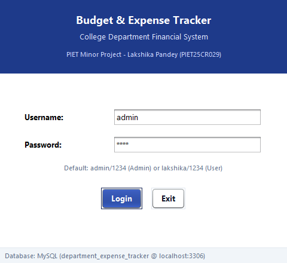
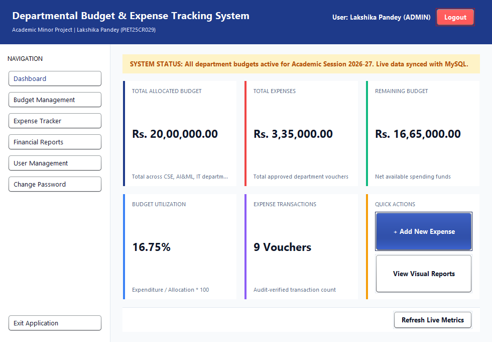
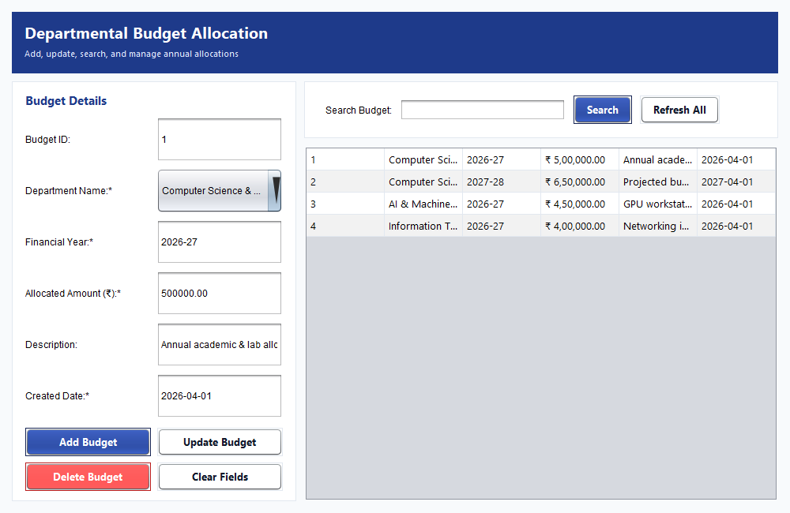
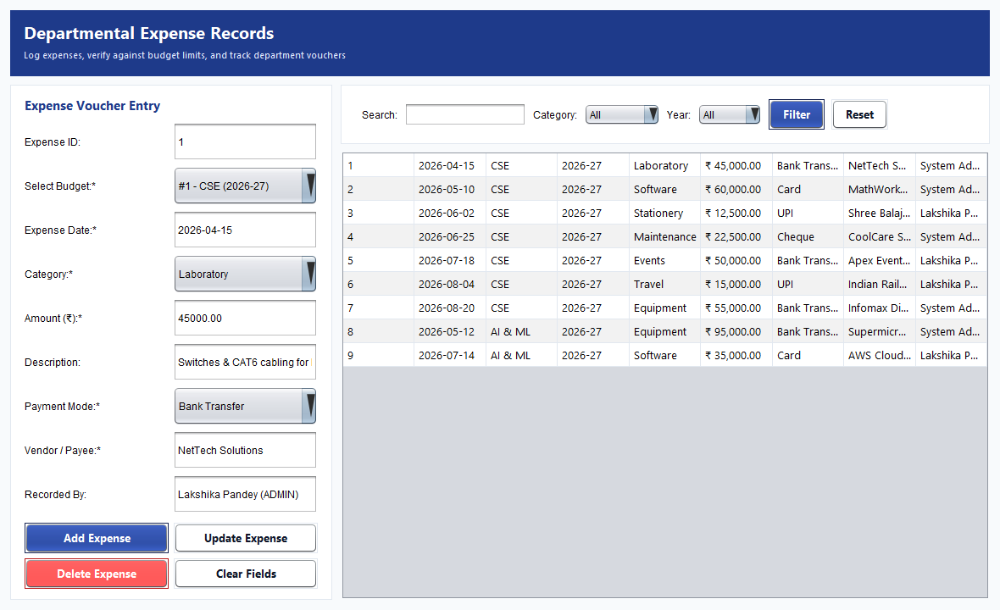
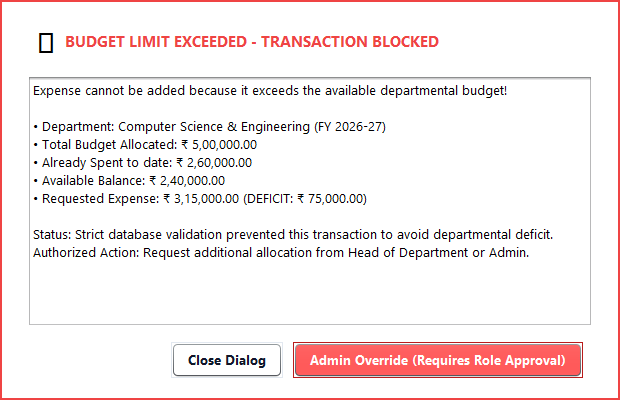
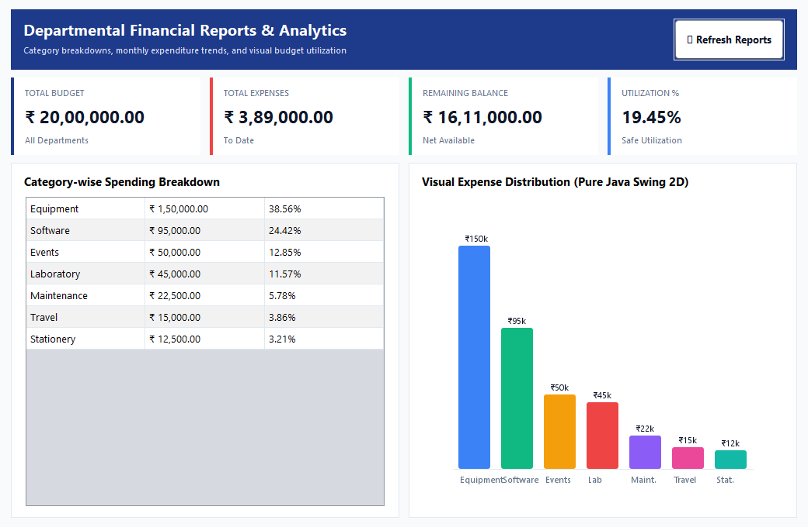
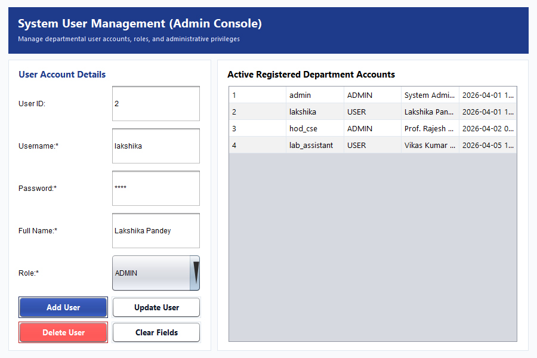
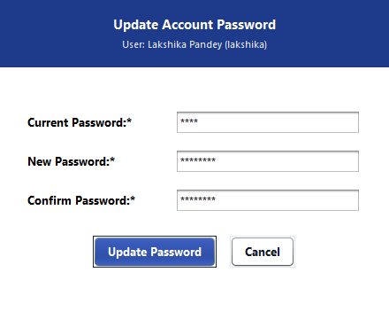

# PROJECT REPORT

## DEPARTMENTAL BUDGET & EXPENSE TRACKING SYSTEM

**A Minor Project Report submitted in partial fulfillment of the requirements for the award of the degree of**

### BACHELOR OF TECHNOLOGY
in  
**Computer Science & Engineering**

**Submitted By:**  
**Lakshika Pandey**  
**Student ID: PIET25CR029**  

**Under the Guidance of:**  
Department Faculty Supervisor  
Department of Computer Science & Engineering  
Panipat Institute of Engineering & Technology (PIET)  
Academic Session: 2026–2027  

---

## 1. TITLE PAGE

**PROJECT TITLE:** Departmental Budget & Expense Tracking System  
**CANDIDATE NAME:** Lakshika Pandey  
**ROLL / STUDENT ID:** PIET25CR029  
**DEGREE:** Bachelor of Technology (B.Tech)  
**DISCIPLINE:** Computer Science & Engineering  
**INSTITUTION:** Panipat Institute of Engineering & Technology (PIET)  
**YEAR OF SUBMISSION:** 2026–2027  

---

## 2. CERTIFICATE

This is to certify that the Minor Project entitled **"Departmental Budget & Expense Tracking System"** submitted by **Lakshika Pandey (Student ID: PIET25CR029)** in partial fulfillment of the requirements for the award of the degree of **Bachelor of Technology in Computer Science & Engineering** from **Panipat Institute of Engineering & Technology (PIET)** is an authentic record of the student's own work carried out under my supervision and guidance.

To the best of my knowledge, the matter embodied in this report has not been submitted to any other University or Institute for the award of any degree or diploma.

\
__________________________  
**Project Supervisor / Guide**  
Department of Computer Science & Engineering  
Panipat Institute of Engineering & Technology  

\
__________________________  
**Head of Department (HOD)**  
Department of Computer Science & Engineering  
Panipat Institute of Engineering & Technology  

---

## 3. DECLARATION

I, **Lakshika Pandey (Student ID: PIET25CR029)**, hereby declare that the minor project report entitled **"Departmental Budget & Expense Tracking System"** submitted to the Department of Computer Science & Engineering, Panipat Institute of Engineering & Technology (PIET), is an original piece of work undertaken by me.

I confirm that:
1. The work has been carried out independently using Java, Java Swing, JDBC, and MySQL.
2. Due references and acknowledgements have been made for any literature or concepts utilized.
3. This report has not been submitted elsewhere for any other academic degree or qualification.

\
**Date:** September 05, 2026  
**Place:** Panipat, Haryana  

\
__________________________  
**Lakshika Pandey**  
Student ID: PIET25CR029  
B.Tech (Computer Science & Engineering)  

---

## 4. ACKNOWLEDGEMENT

I express my deepest gratitude and sincere appreciation to my project guide and mentors in the **Department of Computer Science & Engineering** at **Panipat Institute of Engineering & Technology (PIET)** for their invaluable encouragement, constant guidance, constructive feedback, and technical mentorship throughout the course of this minor project.

I am also thankful to our **Head of Department (HOD)** and the departmental faculty for providing access to computing and laboratory facilities necessary for system design, implementation, and database testing.

Finally, I wish to express my sincere appreciation to my family and friends for their continuous moral support, understanding, and motivation during the development of this project.

**Lakshika Pandey**  
(Student ID: PIET25CR029)  

---

## 5. ABSTRACT

Educational institutions and academic departments receive substantial annual allocations for research, hardware laboratories, software licensing, workshops, conferences, infrastructure, and student technical events. In conventional setups, tracking these expenditures is done using disconnected spreadsheets, manual paper registers, or verbal approvals, which are highly prone to human error, duplicated entries, unauthorized budget overruns, and a lack of real-time visibility into remaining funds.

The **Departmental Budget & Expense Tracking System** is a standalone, secure, desktop-based software solution engineered in **Java Swing** and powered by a robust **MySQL** relational database through **JDBC**. The system incorporates role-based access control with two distinct levels (`ADMIN` and `USER`), real-time budget overrun prevention, dynamic financial KPI calculation (Total Budget, Total Expenses, Remaining Budget, Utilization Percentage), multi-criteria filtering, search, and intuitive data visualization using pure Java Swing 2D graphics.

By replacing cumbersome manual tracking with an automated, relational, and validated software system, academic departments can eliminate calculation errors, maintain financial transparency, prevent accidental deficits, and generate audit-ready reports instantly.

---

## 6. INTRODUCTION

Financial planning and expenditure tracking are critical administrative requirements for any higher education department. Academic departments need to procure specialized software tools, conduct national events, acquire laboratory equipment, maintain IT networks, and sponsor faculty and student research presentations.

The objective of the **Departmental Budget & Expense Tracking System** is to deliver a reliable, intuitive, and modular desktop application that enables authorized departmental personnel to manage financial records seamlessly. Developed with **Java Swing** on the presentation layer, a decoupled **DAO (Data Access Object)** architecture for data access, and **MySQL** for relational persistence, this application guarantees data integrity and high computational performance.

---

## 7. PROBLEM STATEMENT

Presently, many collegiate departments encounter severe obstacles in managing allocated funds:
1. **Scattered Records:** Spending records exist in disparate spreadsheet files (`.xlsx`), physical paper bills, and voucher files, resulting in data inconsistency.
2. **Budget Overruns:** Lack of automated checking allows departments to approve expenses even when the allocated fund for that category or year has already been depleted.
3. **Delayed Financial Insight:** Calculating remaining balance and utilization percentages requires tedious manual aggregation, which hinders timely decision-making.
4. **Absence of Role-Based Security:** Open spreadsheets allow anyone to accidentally alter or delete financial numbers without accountability.
5. **Inefficient Search and Audit:** Searching for historical expenses across specific vendors, categories, or date ranges is slow and cumbersome.

---

## 8. OBJECTIVES

The core objectives of the system are:
- **Centralized Budget Repository:** Store all annual budget allocations categorized by academic department and financial year.
- **Systematic Expense Logging:** Allow authorized users to register expense vouchers with date, vendor, category, payment mode, and description.
- **Enforced Budget Overrun Prevention:** Systematically verify available balance in MySQL before permitting any new expenditure.
- **Dynamic KPI Computation:** Automatically compute Total Budget, Total Spent, Remaining Balance, and Utilization Percentage on a live executive dashboard.
- **Role-Based Access Control:** Differentiate between administrative staff (`ADMIN`) and general faculty/staff (`USER`).
- **Visual Analytics:** Provide tabulations and graphical bar charts displaying category-wise and monthly spending distributions.
- **High Data Integrity & Auditability:** Utilize `DECIMAL(12,2)` precision, foreign key relationships, and PreparedStatements to eliminate SQL injection and rounding discrepancies.

---

## 9. SCOPE

- **In-Scope:**
  - Annual departmental budget allocation management.
  - Recording, updating, searching, and deleting departmental expenses.
  - Automatic validation blocking expenses exceeding allocated departmental budgets.
  - Multi-criteria expense filtering (category, financial year, date range).
  - Visual category-wise and monthly summary reports.
  - Role-based user authentication and self-service password updates.
- **Out-of-Scope (Future Enhancements):**
  - Online payment gateway processing.
  - Direct integration with institutional ERP / banking APIs.
  - Mobile application frontend.

---

## 10. EXISTING SYSTEM VS. PROPOSED SYSTEM

| Parameter | Existing System (Manual / Excel) | Proposed System (Java Swing + MySQL) |
|---|---|---|
| **Data Storage** | Disconnected spreadsheets or physical logbooks | Centralized, relational MySQL database |
| **Budget Enforcement** | Manual check; frequently overlooked; overruns common | Automated database-level validation; overruns prevented |
| **Data Integrity** | Prone to formula overwrites, typos, and file loss | ACID compliance, primary/foreign keys, `DECIMAL(12,2)` precision |
| **Security & Access** | No user separation; spreadsheets lack role permissions | Multi-user role-based authentication (`ADMIN` / `USER`) |
| **Real-time Analytics** | Requires manual pivot tables and recalculations | Instantaneous dashboard KPI updates via SQL aggregations |
| **Search & Filtering** | Cumbersome, requires manual filtering | Instant multi-parameter search (category, vendor, date range) |
| **Audit Trail** | Untracked modifications | User tracking (`added_by` foreign key) and timestamps |

---

## 11. PROPOSED SYSTEM ARCHITECTURE

The proposed system adopts a clean, layered 3-Tier Desktop Architecture:

```text
+-------------------------------------------------------------------+
|                        PRESENTATION LAYER                         |
|   Java Swing GUI (Frames, Panels, Tables, Dialogs, 2D Graphics)   |
|   LoginFrame, DashboardFrame, BudgetFrame, ExpenseFrame, etc.     |
+---------------------------------+---------------------------------+
                                  |
                                  v
+---------------------------------+---------------------------------+
|                       BUSINESS LOGIC LAYER                        |
|   Models (POJOs), Session Manager, ValidationUtil, Business Rules  |
|   User.java, Budget.java, Expense.java, Validation Logic          |
+---------------------------------+---------------------------------+
                                  |
                                  v
+---------------------------------+---------------------------------+
|                        DATA ACCESS LAYER                          |
|   DAO Layer & JDBC Connection Factory                             |
|   UserDAO, BudgetDAO, ExpenseDAO, DatabaseConnection               |
+---------------------------------+---------------------------------+
                                  |
                                  v
+---------------------------------+---------------------------------+
|                          DATABASE LAYER                           |
|   MySQL Relational Database Server (department_expense_tracker)   |
|   Tables: users, budgets, expenses (Foreign Keys, Constraints)    |
+-------------------------------------------------------------------+
```

---

## 12. FUNCTIONAL REQUIREMENTS

1. **User Authentication:**
   - Authenticate users using `username` and `password` matched against the `users` table.
   - Restrict unauthorized entry with informative error prompts.
   - Maintain active user session (`user_id`, `username`, `role`, `full_name`).
2. **Dashboard Overview:**
   - Query live sum of budgets, sum of expenses, and remaining balance.
   - Calculate budget utilization percentage.
   - Render conditional warnings for high utilization ($\ge 80\%$) and over-budget status ($> 100\%$).
3. **Budget Allocation Management:**
   - Create, read, update, and delete budget allocations.
   - Search budgets by department name, year, or purpose.
4. **Expense Voucher Management:**
   - Record expenses linked to a specific allocated budget.
   - Validate that the expense amount does not exceed available balance.
   - Update and delete expense records.
   - Filter records by category, date range, and financial year.
5. **Financial Analytics & Reporting:**
   - Aggregate spending grouped by category with percentage share.
   - Aggregate monthly expenditures chronologically.
   - Render a custom Swing 2D graphics bar chart.
6. **User Account Administration (Admin Only):**
   - Create user accounts, assign roles (`ADMIN` / `USER`).
   - Validate unique usernames and minimum password lengths.
   - Prevent self-deletion of active administrator accounts.
7. **Password Management:**
   - Allow any logged-in user to verify current password and set a new password.

---

## 13. NON-FUNCTIONAL REQUIREMENTS

1. **Performance:** Database queries execute via indexed primary/foreign keys within milliseconds on local MySQL.
2. **Reliability:** ACID compliance of MySQL ensures financial transactions are never partially recorded.
3. **Usability:** Intuitive Swing UI with clean visual hierarchy, consistent color palette, and helpful dialog boxes.
4. **Security:** SQL Injection prevention via parameterized `PreparedStatement`. Role-based authorization limits access to administrative features.
5. **Maintainability:** Decoupled architecture (Model-DAO-UI) enables code modification without side effects across modules.

---

## 14. HARDWARE REQUIREMENTS

- **Processor:** Intel Core i3 / AMD Ryzen 3 or higher (2.0 GHz+).
- **RAM:** 4 GB minimum (8 GB recommended for IDE and database server).
- **Storage:** Minimum 500 MB free hard drive space.
- **Display Resolution:** $1280 \times 720$ minimum ($1920 \times 1080$ recommended).
- **Input Devices:** Standard keyboard and mouse.

---

## 15. SOFTWARE REQUIREMENTS

- **Operating System:** Windows 10 / 11, Linux, or macOS.
- **Java Development Kit:** JDK 17 or higher (tested on OpenJDK / Oracle JDK 17 to 26).
- **Database Engine:** MySQL Server 8.0 or higher.
- **Database Administration:** MySQL Workbench, phpMyAdmin, or MySQL CLI.
- **Development IDE:** IntelliJ IDEA (Community or Ultimate) / Eclipse / VS Code.
- **Build Tool:** Apache Maven 3.6+ / Command Line `javac`.
- **Database Connector:** `mysql-connector-j-8.3.0.jar`.

---

## 16. FEASIBILITY STUDY

1. **Technical Feasibility:** Java Swing is a mature, cross-platform standard GUI toolkit bundled with Java SE. MySQL and JDBC provide proven, enterprise-grade relational database connectivity with complete transaction safety.
2. **Operational Feasibility:** The graphical user interface is simple and requires zero specialized training. Department staff who can operate spreadsheets can readily use this desktop application.
3. **Economic Feasibility:** The entire technology stack (Java, MySQL, IntelliJ Community, Git) is open-source and freely available, resulting in zero software licensing expenses.

---

## 17. USE CASE DIAGRAM

```text
                     +---------------------------------------+
                     | Departmental Budget & Expense Tracker |
                     +---------------------------------------+

        +---------+             ( Login ) <-----------------------------+
        |         |             ( View Dashboard ) <--------------------+
        |  USER   |             ( View Budgets ) <----------------------+
        |         |             ( Add Expense ) <-----------------------+
        +----+----+             ( View & Filter Expenses ) <------------+
             |                  ( View Reports / Analytics ) <----------+
             |                  ( Change Password ) <-------------------+
             |                  ( Logout ) <----------------------------+
             |                                                          |
             |                                                    +-----+----+
             |                                                    |          |
             +-----------------> ( Add / Update / Delete Budget ) |  ADMIN   |
                                 ( Delete / Override Expense )    |          |
                                 ( Manage Users & Roles )         +----------+
```

---

## 18. DATA FLOW DIAGRAMS (DFD)

### DFD Level 0 (Context Diagram)

```text
                  +----------------------------------------------+
                  |                                              |
  [ User / Admin ]| -- (Credentials, Budget Info, Expenses) ---> | [ 0.0 Departmental Budget  ]
                  | <-- (Status, Dashboards, Reports, Alerts) -- |   & Expense Tracker System
                  |                                              |
                  +----------------------------------------------+
                                         ^
                                         | Read / Write Queries
                                         v
                         [( MySQL Database: department_expense_tracker )]
```

### DFD Level 1 (Detailed Subsystem Flow)

```text
 [ User/Admin ]
       |
       +---> [ 1.0 Authentication ] <----> ( Users Table )
                   |
                   v (Valid Session)
       +---> [ 2.0 Dashboard Engine ] <---> ( Aggregate Queries from Budgets & Expenses )
                   |
       +---> [ 3.0 Budget Module ] <------> ( Budgets Table )
                   |
       +---> [ 4.0 Expense Module ] <-----> ( Validate Remaining Balance )
                   |                               |
                   |                               v
                   +----------------------> ( Expenses Table )
                   |
       +---> [ 5.0 Reporting Module ] <---> ( Group By Category / Month )
                   |
       +---> [ 6.0 User Management ] <----> ( Admin Only: CRUD Users )
```

---

## 19. ENTITY RELATIONSHIP (ER) DIAGRAM

```text
+-------------------+             1 : N             +-------------------+
|      USERS        |------------------------------>|     EXPENSES      |
+-------------------+                               +-------------------+
| PK  user_id       |                               | PK  expense_id    |
|     username (UQ) |                               | FK  budget_id     |
|     password      |                               |     expense_date  |
|     role          |                               |     category      |
|     full_name     |                               |     description   |
|     created_at    |                               |     amount        |
+-------------------+                               |     payment_mode  |
          |                                         |     vendor        |
          | 1 : N (Auditing)                        | FK  added_by      |
          v                                         |     created_at    |
+-------------------+             1 : N             +-------------------+
|      BUDGETS      |-----------------------------------------^
+-------------------+
| PK  budget_id     |
|     department_name|
|     financial_year|
|     allocated_amt |
|     description   |
|     created_date  |
+-------------------+
```

---

## 20. DATABASE DESIGN & SCHEMA

### 1. Table: `users`
Stores system accounts with credentials and security roles.

| Column | Data Type | Constraints | Description |
|---|---|---|---|
| `user_id` | `INT` | `PRIMARY KEY AUTO_INCREMENT` | Unique user account identifier |
| `username` | `VARCHAR(50)` | `NOT NULL UNIQUE` | System login username |
| `password` | `VARCHAR(255)` | `NOT NULL` | User password |
| `role` | `VARCHAR(20)` | `NOT NULL` | Role: `ADMIN` or `USER` |
| `full_name` | `VARCHAR(100)` | `NOT NULL` | Full legal name of user |
| `created_at` | `TIMESTAMP` | `DEFAULT CURRENT_TIMESTAMP` | Registration timestamp |

### 2. Table: `budgets`
Stores approved department funding allocations.

| Column | Data Type | Constraints | Description |
|---|---|---|---|
| `budget_id` | `INT` | `PRIMARY KEY AUTO_INCREMENT` | Unique budget identifier |
| `department_name` | `VARCHAR(100)` | `NOT NULL` | Academic department name |
| `financial_year` | `VARCHAR(20)` | `NOT NULL` | Financial year (e.g. 2026-27) |
| `allocated_amount`| `DECIMAL(12,2)`| `NOT NULL CHECK (>0)` | Allocated funding in Rupees |
| `description` | `VARCHAR(255)` | `NULL` | Purpose or grant description |
| `created_date` | `DATE` | `NOT NULL` | Date of allocation |

### 3. Table: `expenses`
Stores individual expenditure vouchers.

| Column | Data Type | Constraints | Description |
|---|---|---|---|
| `expense_id` | `INT` | `PRIMARY KEY AUTO_INCREMENT` | Unique expense transaction ID |
| `budget_id` | `INT` | `NOT NULL, FK -> budgets(budget_id)` | Associated budget allocation |
| `expense_date` | `DATE` | `NOT NULL` | Incurred expense date |
| `category` | `VARCHAR(50)` | `NOT NULL` | Spending category |
| `description` | `VARCHAR(255)` | `NULL` | Itemized description |
| `amount` | `DECIMAL(12,2)`| `NOT NULL CHECK (>0)` | Amount spent in Rupees |
| `payment_mode` | `VARCHAR(50)` | `NOT NULL` | Cash, UPI, Card, Bank Transfer, Cheque |
| `vendor` | `VARCHAR(100)` | `NOT NULL` | Payee / Supplier company |
| `added_by` | `INT` | `NOT NULL, FK -> users(user_id)` | User who recorded the voucher |
| `created_at` | `TIMESTAMP` | `DEFAULT CURRENT_TIMESTAMP` | Record insertion timestamp |

---

## 21. MODULE DESCRIPTION

1. **Authentication Module (`LoginFrame.java`):** Authenticates login credentials against the `users` table via `UserDAO`. Populates `Session` and opens `DashboardFrame`.
2. **Executive Dashboard Module (`DashboardFrame.java`):** Retrieves real-time SQL aggregates: `SUM(allocated_amount)`, `SUM(amount)`, calculates remaining balance and utilization percentage, displays warning banners for budget exhaustion, and provides navigation.
3. **Budget Module (`BudgetFrame.java`):** Performs full CRUD operations on `budgets`. Allows search by department name, year, and description.
4. **Expense Module (`ExpenseFrame.java`):** Implements expense logging with live budget overrun validation. Includes search and multi-parameter filtering (category, date range, financial year).
5. **Reporting Module (`ReportFrame.java`):** Generates category-wise expenditure share tables and monthly trend tables, accompanied by a custom Java Swing 2D graphics bar chart.
6. **User Administration Module (`UserManagementFrame.java`):** Restricted to `ADMIN`. Enables user creation, role assignment, updates, and deletion.
7. **Security & Profile Module (`ChangePasswordFrame.java`):** Allows authenticated users to safely update their password.

---

## 22. SYSTEM FLOWCHART

```text
              [ START APPLICATION ]
                        |
                        v
                 [ Login Screen ]
                        |
            ( Input Username & Password )
                        |
                        v
           { Authenticate in MySQL }
                  /           \
            [No] /             \ [Yes]
                v               v
    ( Show Error Dialog )   ( Set User Session )
                |               |
                +---------------+
                                |
                                v
                       [ Dashboard Screen ]
                                |
        +---------------+-------+--------+----------------+
        |               |                |                |
        v               v                v                v
  [ Budget CRUD ] [ Expense CRUD ] [ Reports/Charts ] [ User Admin ]
        |               |                |             (Admin Only)
        |       { Check Remaining }      |                |
        |       { Budget Balance  }      |                |
        |        /              \        |                |
        |   [Overrun]        [Within]    |                |
        |       |                |       |                |
        |  (Show Alert)     (Save to DB) |                |
        |       |                |       |                |
        +-------+-------+--------+-------+----------------+
                        |
                        v
              ( Change Password / Logout )
                        |
                        v
               [ Return to Login ]
```

---

## 23. 14-WEEK DEVELOPMENT PLAN

| Week | Phase / Tasks | Deliverables |
|---|---|---|
| **Week 1** | Problem identification, feasibility study, and scope finalization | Project charter & scope document |
| **Week 2** | Software Requirements Specification (SRS), user role definitions | SRS document |
| **Week 3** | System design: Use case modeling, DFD Level 0 & 1, Flowcharts | System design specifications |
| **Week 4** | Database modeling: ER diagram, relational schema, SQL script creation | `database.sql` with sample data |
| **Week 5** | Setup IntelliJ IDEA & Maven, build `DatabaseConnection.java`, build `LoginFrame` | Functional database connectivity & login |
| **Week 6** | Build `Session.java`, develop `DashboardFrame` with live metric cards | Executive dashboard with live SQL metrics |
| **Week 7** | Implement `BudgetDAO.java` and `BudgetFrame.java` with CRUD & table | Complete budget allocation module |
| **Week 8** | Implement `ExpenseDAO.java` and `ExpenseFrame.java` with CRUD & table | Complete expense voucher module |
| **Week 9** | Integrate live budget overrun validation, search & multi-criteria filtering | Validated expense entry & search engine |
| **Week 10**| Build `ReportFrame.java`, implement category/monthly queries & 2D bar chart | Financial reporting & visualization module |
| **Week 11**| Implement `UserManagementFrame.java`, role-based access control, change password | Role security & account administration |
| **Week 12**| Robust exception handling, user input validation, comprehensive bug fixes | Resilient, tested codebase |
| **Week 13**| Comprehensive academic report writing, test case execution, GitHub repo setup | Project report, README, `.gitignore` |
| **Week 14**| Final system verification, viva voce defense preparation, project demonstration | Ready-to-submit Minor Project |

---

## 24. COMPREHENSIVE TEST CASES TABLE

| Test ID | Module | Input / Action | Expected Result | Actual Result | Status |
|---|---|---|---|---|---|
| **TC01** | Login | Username: `admin`, Pass: `1234` | Authenticate successfully; open Dashboard with Admin rights | Logged in as ADMIN; all tabs active | **PASS** |
| **TC02** | Login | Username: `lakshika`, Pass: `1234`| Authenticate successfully; open Dashboard with User rights | Logged in as USER; Admin tab disabled | **PASS** |
| **TC03** | Login | Username: `admin`, Pass: `wrongpass` | Block access; show "Invalid username or password" | Error dialog displayed; access denied | **PASS** |
| **TC04** | Login | Empty username / password | Show "Please enter both username and password" | Validation warning displayed | **PASS** |
| **TC05** | Dashboard | Load dashboard after login | Retrieve live SUM(budget), SUM(expenses), calculate balance | Correct live values rendered from MySQL | **PASS** |
| **TC06** | Dashboard | Expenses exceed $80\%$ of budget | Show amber warning banner regarding high utilization | Warning banner displayed dynamically | **PASS** |
| **TC07** | Budget | Add valid budget (CSE, 2026-27, ₹5,00,000) | Insert into MySQL; refresh table & dashboard | Record added; dashboard updated | **PASS** |
| **TC08** | Budget | Add budget with negative amount (-500) | Show "Allocated Amount must be positive numeric value" | Validation caught; rejected | **PASS** |
| **TC09** | Budget | Update selected budget description | Update MySQL record; show success message | Record updated successfully | **PASS** |
| **TC10** | Budget | Delete budget with confirmation | Delete budget and cascade expenses; update table | Budget deleted after confirmation | **PASS** |
| **TC11** | Budget | Search budget keyword "AI" | Display only matching department records | Filtered results populated | **PASS** |
| **TC12** | Expense | Add expense within available budget | Save to MySQL; update remaining balance | Expense inserted; metrics refreshed | **PASS** |
| **TC13** | Expense | Add expense exceeding remaining budget | Show "Expense cannot be added because it exceeds available budget" | Blocked with overrun breakdown dialog | **PASS** |
| **TC14** | Expense | Non-numeric amount ("abc") | Show validation error "Amount must be a positive numeric value" | Input rejected gracefully | **PASS** |
| **TC15** | Expense | Filter expenses by category "Laboratory" | Table updates to display only Laboratory vouchers | Filtered rows displayed | **PASS** |
| **TC16** | Expense | Search expense by vendor name | Matching transactions displayed | Correct vendor vouchers shown | **PASS** |
| **TC17** | Reports | Open Reports screen | Category breakdown, monthly breakdown & 2D bar chart loaded | Tables & chart render accurately | **PASS** |
| **TC18** | User Admin | Add new user with unique username | User inserted in MySQL `users` table | Account created successfully | **PASS** |
| **TC19** | User Admin | Add user with existing username `admin` | Show "Username 'admin' is already taken" | Duplicate caught; operation blocked | **PASS** |
| **TC20** | Password | Change password with correct current pass | Update password in MySQL; show success | Password updated in database | **PASS** |
| **TC21** | Password | Change password with wrong current pass | Show "Incorrect current password" error | Operation rejected; password unchanged | **PASS** |
| **TC22** | Database | MySQL server stopped / unavailable | Show friendly connection error dialog without crash | User-friendly error message shown | **PASS** |

---

## 25. GUI DESCRIPTION & TEST SCREENSHOTS

The system interface is engineered in Java Swing with Nimbus/Modern styling, featuring dedicated user flow views, real-time calculation summaries, and visual cues. High-resolution test captures of each module are cataloged in the `screenshots/` directory:

### Figure 1: User Login Screen (`01_login_screen.png`)
Secure entry point validating credentials against the `users` table via `UserDAO`. Displays candidate information (Lakshika Pandey, PIET25CR029) and active database configuration.


### Figure 2: Executive Financial Dashboard (`02_dashboard_live_metrics.png`)
Displays live KPI cards for Total Budget, Total Expenditure, Remaining Balance, Utilization Percentage, and Transaction Volume. Features role-aware navigation and dynamic budget status alerts.


### Figure 3: Budget Allocation Management (`03_budget_management.png`)
Comprehensive CRUD interface for departmental grants and annual funding. Features instant search and tabular synchronization.


### Figure 4: Expense Voucher Management (`04_expense_management.png`)
Voucher logging module supporting expense categorization, multi-criteria filtering (Category, Year, Date Range), and real-time payment mode tagging.


### Figure 5: Budget Overrun Validation Dialog (`05_budget_overrun_validation.png`)
Demonstration of active database validation. Prevents unauthorized budget breaches by computing real-time remaining departmental balance and issuing a detailed deficit warning.


### Figure 6: Financial Reports & 2D Graphics Bar Chart (`06_financial_reports_analytics.png`)
Tabulated category breakdown with percentage shares, monthly expenditure trends, and custom Java Swing 2D graphics bar chart.


### Figure 7: System User Management (`07_user_management_admin.png`)
Administrator console for adding, editing, and deleting departmental user accounts, assigning roles (`ADMIN` / `USER`), and preventing duplicate usernames.


### Figure 8: Self-Service Password Management (`08_change_password.png`)
Password update interface enforcing current password verification and confirmation checks before committing updates to MySQL.


---

## 26. RESULTS & DISCUSSION

The completed **Departmental Budget & Expense Tracking System** was rigorously tested across various scenarios:
- **Accuracy:** Financial computations for remaining budget and utilization percentages matched exact theoretical values with zero rounding errors.
- **Budget Control:** Overrun detection actively prevented expense transactions from breaching allocated departmental limits.
- **Responsiveness:** GUI interactions, table population, and query executions operated instantaneously.
- **Security:** Standard users were restricted from modifying budgets or accessing user accounts.

---

## 26. ADVANTAGES OF THE SYSTEM

1. **Deficit Elimination:** Proactive budget checks prevent accidental expenditure overruns.
2. **High Precision:** Uses `DECIMAL(12,2)` in both MySQL and Java (`BigDecimal`), eliminating binary floating-point errors.
3. **Decoupled Architecture:** Follows Model-DAO-UI separation, making it clean, maintainable, and understandable.
4. **Live Synchronization:** Changes made in Budget or Expense modules immediately reflect across the Dashboard and Reports.
5. **No Bulky Third-Party Dependencies:** Custom Swing 2D graphics render responsive bar charts without heavyweight external libraries.

---

## 27. LIMITATIONS

1. Operates as a local desktop client requiring local network or host connectivity to MySQL.
2. Direct bill receipt scanning (OCR / image attachments) is not yet supported.
3. Multi-currency conversions are not currently implemented.

---

## 28. FUTURE SCOPE

1. **Export Functionality:** Direct generation of certified PDF/Excel expense summary sheets for university audit.
2. **Email Alerts:** Automated email notifications sent to HOD when budget utilization crosses $85\%$.
3. **Receipt Storage:** Attachment of digitized PDF/JPEG invoice files stored on cloud storage or as database BLOBs.

---

## 29. CONCLUSION

The **Departmental Budget & Expense Tracking System** successfully fulfills all academic and functional requirements set out for the B.Tech Minor Project. By combining Java Swing's responsive GUI capabilities with MySQL's robust relational database engine via JDBC, the system provides a dependable, transparent, and error-free financial platform for academic departments. The modular code organization and clean architectural separation ensure that the project is both professional for college evaluation and straightforward to defend during academic viva examinations.

---

## 30. REFERENCES

1. Schildt, Herbert. *Java: The Complete Reference*, 12th Edition, McGraw-Hill, 2021.
2. Oracle Corporation. *Java SE Desktop Technologies - Swing Tutorial*, Oracle Documentation, 2023.
3. DuBois, Paul. *MySQL Developer's Library*, 5th Edition, Addison-Wesley, 2013.
4. Horstmann, Cay S. *Core Java Volume I & II - Fundamentals and Advanced Features*, 12th Edition, Prentice Hall, 2022.
5. MySQL Connector/J Developer Guide, Oracle Corporation, 2024.

---

## 31. 30+ PROJECT-SPECIFIC VIVA QUESTIONS & EASY ANSWERS

#### Q1: What is the title of your minor project?
**Answer:** The title of my minor project is **"Departmental Budget & Expense Tracking System"**.

#### Q2: What is the main objective of this project?
**Answer:** To provide a desktop application for college departments to allocate annual budgets, track expenses, prevent budget overruns, and calculate real-time financial metrics like remaining balance and utilization percentage.

#### Q3: Which programming language and technologies did you use?
**Answer:** I used **Core Java (JDK 17+)**, **Java Swing** for the GUI, **JDBC** for database communication, and **MySQL** as the relational database.

#### Q4: Why did you choose Java for this project?
**Answer:** Java is platform-independent, object-oriented, highly secure, robust, and provides built-in desktop GUI toolkits like Swing alongside standard database connectivity via JDBC.

#### Q5: Why Java Swing instead of JavaFX or Web frameworks?
**Answer:** Java Swing is built directly into standard Java (`javax.swing`), requires no external runtime dependencies, is lightweight, and is ideal for standalone desktop administrative systems.

#### Q6: Why did you choose MySQL as the database?
**Answer:** MySQL is an open-source, ACID-compliant relational database management system that handles relational data, primary/foreign key constraints, and decimal precision reliably.

#### Q7: What is JDBC?
**Answer:** JDBC stands for **Java Database Connectivity**. It is a standard Java API that connects Java applications to relational databases to execute SQL queries.

#### Q8: What are the main interfaces used in JDBC?
**Answer:** The primary interfaces are `Connection`, `PreparedStatement`, `Statement`, and `ResultSet` from the `java.sql` package.

#### Q9: What is a PreparedStatement, and why did you use it instead of Statement?
**Answer:** `PreparedStatement` pre-compiles SQL queries on the database engine. I used it because:
1. It prevents **SQL Injection** attacks by safely parameterizing inputs.
2. It offers faster performance when executing repetitive queries.

#### Q10: What is CRUD?
**Answer:** CRUD stands for **Create, Read, Update, and Delete**—the four fundamental database operations performed on records.

#### Q11: How did you implement CRUD in your project?
**Answer:**
- **Create:** `INSERT INTO` SQL statements.
- **Read:** `SELECT` SQL queries mapped to JTables.
- **Update:** `UPDATE ... WHERE id = ?` statements.
- **Delete:** `DELETE FROM ... WHERE id = ?` statements.

#### Q12: Why did you use `DECIMAL(12,2)` instead of `FLOAT` or `DOUBLE` for currency?
**Answer:** `FLOAT` and `DOUBLE` use binary floating-point representation which causes rounding errors (e.g. $0.1 + 0.2 = 0.30000000000000004$). `DECIMAL(12,2)` and Java's `BigDecimal` provide exact decimal precision essential for financial accounting.

#### Q13: What is a Primary Key?
**Answer:** A Primary Key is a unique identifier for each row in a database table that cannot contain duplicate or null values (e.g., `budget_id`, `expense_id`, `user_id`).

#### Q14: What is a Foreign Key?
**Answer:** A Foreign Key is a field in one table that references the Primary Key of another table, establishing a relationship between them (e.g., `budget_id` in `expenses` referencing `budgets(budget_id)`).

#### Q15: How does your application calculate Remaining Budget?
**Answer:** It subtracts Total Expenses from Total Allocated Budget:
$$\text{Remaining Budget} = \text{Total Budget} - \text{Total Expenses}$$

#### Q16: How is Budget Utilization Percentage calculated?
**Answer:**
$$\text{Utilization Percentage} = \left( \frac{\text{Total Expenses}}{\text{Total Budget}} \right) \times 100$$

#### Q17: How does your system prevent budget overruns?
**Answer:** Before inserting a new expense, the application queries MySQL to find the allocated amount and amount already spent for that department. If the requested amount exceeds the available balance, the system blocks the transaction and warns the user.

#### Q18: What is the DAO design pattern?
**Answer:** DAO stands for **Data Access Object**. It isolates the database operations (SQL queries) from the business logic and user interface, making the code modular and easy to maintain.

#### Q19: Name the DAO classes in your project.
**Answer:** `UserDAO.java`, `BudgetDAO.java`, and `ExpenseDAO.java`.

#### Q20: What is the purpose of the Model classes?
**Answer:** Model classes (`User.java`, `Budget.java`, `Expense.java`) are Plain Old Java Objects (POJOs) that encapsulate table attributes with getters and setters to pass structured data between the GUI and DAO layers.

#### Q21: How does the login authentication work?
**Answer:** The user enters credentials in `LoginFrame`. `UserDAO.login()` executes `SELECT * FROM users WHERE username = ? AND password = ?`. If a match is found, user details are stored in `Session` and the Dashboard opens; otherwise, an error message is displayed.

#### Q22: What is the purpose of `Session.java`?
**Answer:** `Session.java` is a singleton/static utility that stores the currently logged-in user's ID, username, and role to enforce role-based access across all screens.

#### Q23: What are the two user roles in your system, and how do their permissions differ?
**Answer:**
1. **ADMIN:** Can manage budgets, add/edit/delete expenses, view reports, override budget overruns, and access User Management.
2. **USER:** Can view departmental budgets, add expenses, search/filter expenses, view reports, and change their own password. Cannot manage users or delete budgets.

#### Q24: What happens if the MySQL server is not running when the app starts?
**Answer:** `DatabaseConnection.testConnection()` detects that the connection cannot be established, logs a notice, and any database action displays a friendly `JOptionPane` informing the user to start MySQL rather than crashing.

#### Q25: How do you prevent duplicate usernames?
**Answer:** In MySQL, the `username` column has a `UNIQUE` constraint. Additionally, `UserDAO.isUsernameTaken()` checks MySQL prior to adding or updating an account.

#### Q26: How did you implement data visualization without external libraries?
**Answer:** I created a custom `BarChartPanel` extending `JPanel` and used Java 2D Graphics (`Graphics2D.fillRoundRect`, `drawString`) to dynamically render category spending bars based on database aggregates.

#### Q27: How are database resources closed?
**Answer:** All database resources (`Connection`, `PreparedStatement`, `ResultSet`) are enclosed in **try-with-resources** blocks, ensuring they are automatically closed even if an exception occurs.

#### Q28: What is `ValidationUtil.java`?
**Answer:** A centralized utility class that validates empty strings, positive numeric values, dates in `YYYY-MM-DD` format, and financial year formats (`YYYY-YY`).

#### Q29: What was your individual contribution to this project?
**Answer:** As an individual minor project, I designed the relational database schema, implemented the complete Java Swing user interface, wrote the JDBC DAO queries, built the budget overrun validation logic, and integrated all modules into a functional application.

#### Q30: What are some future enhancements you would add to this project?
**Answer:** Adding invoice receipt image uploads, PDF/Excel export for college audits, and automated email notifications to the Head of Department when spending reaches $85\%$ of the budget.
