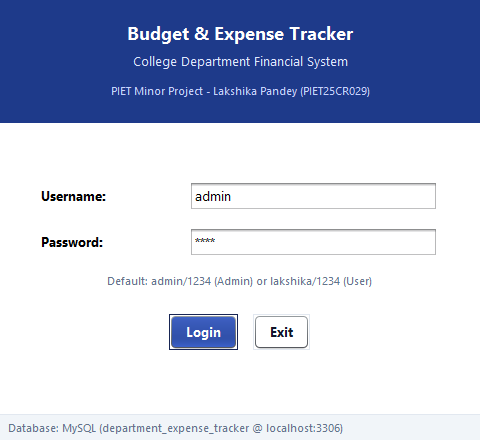
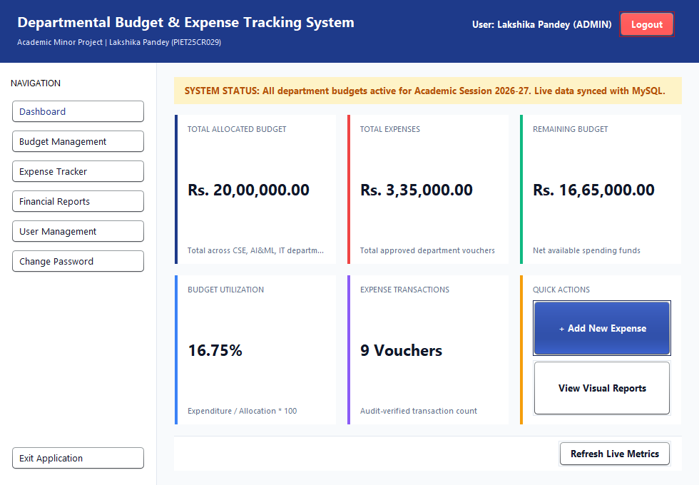
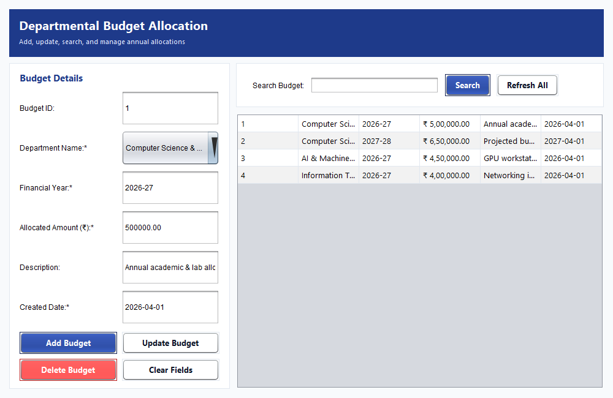
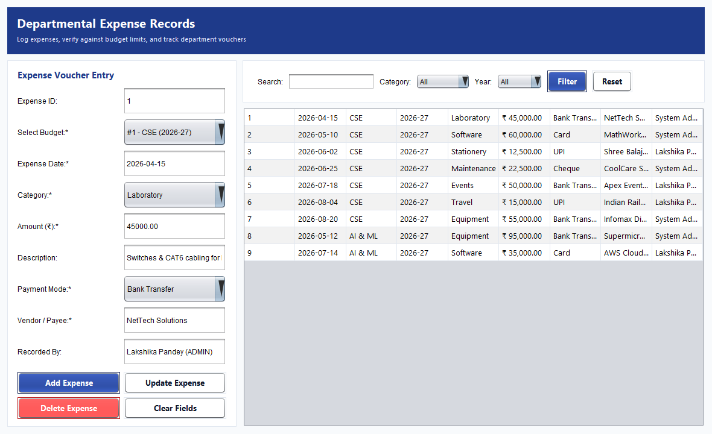
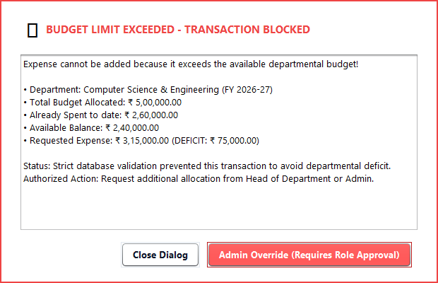
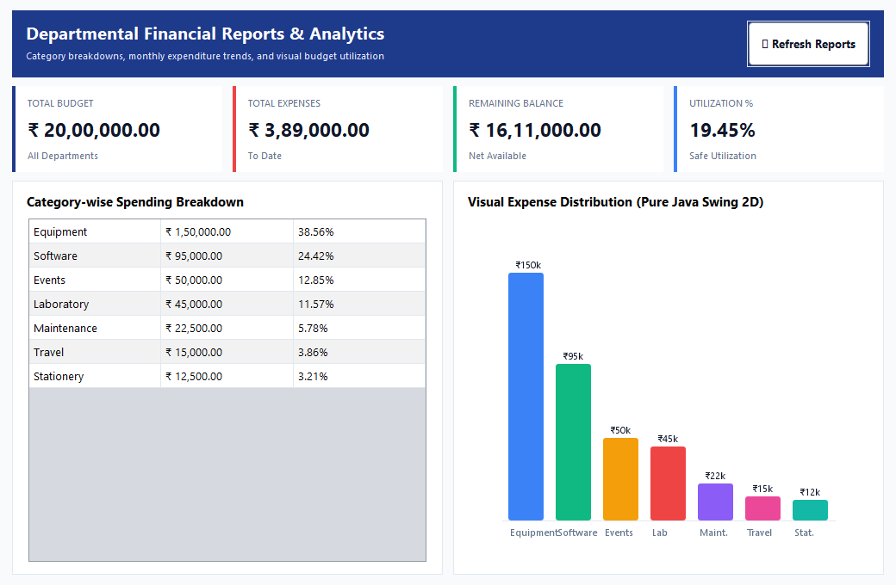
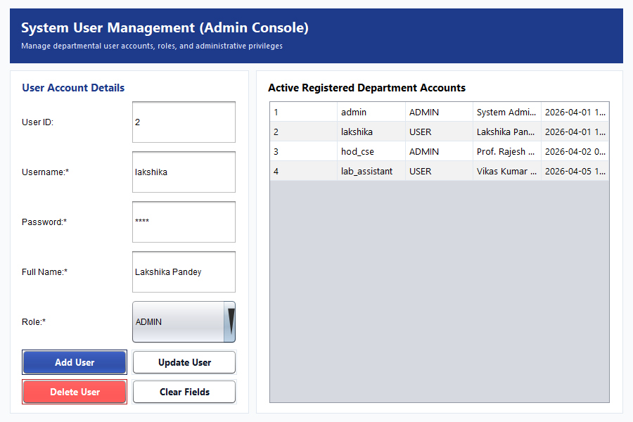
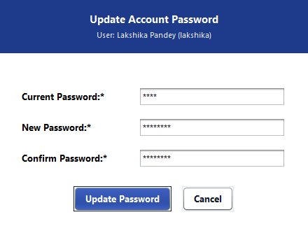

# Departmental Budget & Expense Tracking System

**Individual B.Tech Minor Project**  
**Student Name:** Lakshika Pandey  
**Student ID:** PIET25CR029  
**Institution:** Panipat Institute of Engineering & Technology (PIET)  
**Academic Year:** 2026-27  

---

## 📌 Project Overview

The **Departmental Budget & Expense Tracking System** is a robust, desktop-based financial management software developed using **Java Swing**, **Core Java**, **JDBC**, and **MySQL**. It is specifically designed for college academic departments (e.g., Computer Science & Engineering, AI & Machine Learning, IT) to maintain departmental budget allocations, record and categorize everyday expenses, prevent budget overruns through live database validation, calculate real-time financial metrics (remaining budget, utilization percentage), and generate financial summary reports.

---

## 🎯 Objectives

1. **Centralized Financial Control:** Maintain annual budget allocations across academic departments in a structured relational database.
2. **Real-Time Spending Tracking:** Record day-to-day expenditures categorized by domain (Laboratory, Software, Equipment, Events, Travel, Maintenance, Stationery, etc.).
3. **Budget Overrun Prevention:** Systematically check available funds prior to logging an expense, preventing unauthorized budget deficits.
4. **Dynamic Analytics:** Real-time calculation of key financial KPIs:
   $$\text{Total Budget} = \sum \text{allocated\_amount}$$
   $$\text{Total Expenses} = \sum \text{expense amount}$$
   $$\text{Remaining Budget} = \text{Total Budget} - \text{Total Expenses}$$
   $$\text{Utilization Percentage} = \left( \frac{\text{Total Expenses}}{\text{Total Budget}} \right) \times 100$$
5. **Role-Based Security:** Strict access separation between `ADMIN` (full CRUD, user management, budget override) and `USER` (voucher entry, expense management, viewing reports).

---

## 🛠️ Technology Stack

| Layer | Technology | Description |
|---|---|---|
| **GUI / Presentation** | Java Swing & AWT | Standard desktop components (`JFrame`, `JPanel`, `JTable`, `Graphics2D`) |
| **Business Logic** | Core Java (JDK 17+) | Object-Oriented Architecture, Models, Utilities |
| **Data Access** | JDBC (`java.sql.*`) | `Connection`, `PreparedStatement`, `ResultSet`, `SQLException` |
| **Database Engine** | MySQL Server 8.0+ | Relational schema, Primary/Foreign keys, `DECIMAL(12,2)` precision |
| **Build & Project Mgmt** | Apache Maven / IntelliJ IDEA | Standard Maven lifecycle (`pom.xml`) |
| **Version Control** | Git & GitHub | Modular structure and version management |

---

## 🗄️ MySQL Database Configuration

All database credentials are centralized in `DatabaseConnection.java`.

- **Host:** `localhost`
- **Port:** `3306`
- **Database Name:** `department_expense_tracker`
- **Username:** `root`
- **Password:** `1234`
- **JDBC URL:** `jdbc:mysql://localhost:3306/department_expense_tracker?useSSL=false&allowPublicKeyRetrieval=true&serverTimezone=UTC`

> **Note on Academic Credentials:** The database password `1234` is configured for local academic evaluation and testing purposes. In production environments, credentials should be loaded from secure environment variables or external configuration files.

---

## 📂 Project Architecture & Directory Structure

```text
NINORNSP/
├── pom.xml                                      # Maven configuration
├── database.sql                                 # Complete schema, constraints & sample data
├── README.md                                    # Comprehensive setup & project guide
├── DOCUMENTATION.md                             # Complete 33-section academic minor project report
├── .gitignore                                   # Standard Java/Maven/IntelliJ gitignore
├── run.bat                                      # One-click Windows Batch execution script
├── run.ps1                                      # PowerShell execution script
├── lib/
│   └── mysql-connector-j-8.3.0.jar              # MySQL Connector/J driver library
└── src/main/java/com/department/tracker/
    ├── Main.java                                # Application bootstrap & theme initialization
    ├── model/
    │   ├── User.java                            # User POJO model
    │   ├── Budget.java                          # Budget allocation POJO model
    │   └── Expense.java                         # Expense voucher POJO model
    ├── dao/
    │   ├── UserDAO.java                         # User authentication & management queries
    │   ├── BudgetDAO.java                       # Budget CRUD & summary queries
    │   └── ExpenseDAO.java                      # Expense CRUD, search, filter & analytics
    ├── util/
    │   ├── DatabaseConnection.java              # Centralized JDBC connection pool/factory
    │   ├── Session.java                         # Current user session holder & role checks
    │   └── ValidationUtil.java                  # Input & date format validation methods
    └── ui/
        ├── UITheme.java                         # Consistent color palette, fonts & buttons
        ├── LoginFrame.java                      # Secure login GUI against MySQL users table
        ├── DashboardFrame.java                  # Live KPI cards, alerts, navigation sidebar
        ├── BudgetFrame.java                     # Budget allocation CRUD & search GUI
        ├── ExpenseFrame.java                    # Expense entry, search, filter & overrun check
        ├── ReportFrame.java                     # Tabular summaries & custom 2D bar chart
        ├── UserManagementFrame.java             # Admin-only user account management
        └── ChangePasswordFrame.java             # Self-service password change GUI
```

---

## 🚀 Setup & Execution Guide

### 1. Database Setup in MySQL

1. Open **MySQL Workbench**, **phpMyAdmin**, or the **MySQL Command Line Client**.
2. Connect using `root` and password `1234`.
3. Open or execute the script `database.sql`:
   ```bash
   mysql -u root -p1234 < database.sql
   ```
4. This script automatically creates the database `department_expense_tracker`, builds the tables (`users`, `budgets`, `expenses`), sets primary/foreign key constraints, and seeds realistic demo data.

### 2. Running the Application

#### Option A: One-Click Run (Windows)
Double-click `run.bat` or run PowerShell:
```powershell
.\run.ps1
```

#### Option B: In IntelliJ IDEA
1. Open IntelliJ IDEA.
2. Select **File -> Open...** and choose the `NINORNSP` directory.
3. IntelliJ will recognize the `pom.xml` file as a Maven project and automatically resolve dependencies.
4. Navigate to `src/main/java/com/department/tracker/Main.java`.
5. Right-click and choose **Run 'Main.main()'**.

#### Option C: Command Line (javac & java)
```bash
# Compile
javac -cp "lib/mysql-connector-j-8.3.0.jar" -d bin src/main/java/com/department/tracker/model/*.java src/main/java/com/department/tracker/util/*.java src/main/java/com/department/tracker/dao/*.java src/main/java/com/department/tracker/ui/*.java src/main/java/com/department/tracker/Main.java

# Run
java -cp "bin;lib/mysql-connector-j-8.3.0.jar" com.department.tracker.Main
```

---

## 🔑 Default Login Credentials

| Role | Username | Password | Full Name | Access Privileges |
|---|---|---|---|---|
| **ADMIN** | `admin` | `1234` | System Administrator | Full access: Budgets, Expenses, Reports, User Management, Overrun Override |
| **USER** | `lakshika` | `1234` | Lakshika Pandey | Expense logging, Viewing budgets, Search/filter, Reports, Change password |

---

## 🖥️ Modules & Functional Features

1. **Authentication & Session (`LoginFrame`):**
   - Live query authentication against `users` table using `PreparedStatement`.
   - Populates global `Session` with User ID, Username, and Role.
2. **Executive Dashboard (`DashboardFrame`):**
   - Live calculations: Total Budget, Total Expenses, Remaining Budget, Utilization %.
   - High-utilization warning banner ($> 80\%$) and Over-budget critical alert ($> 100\%$).
   - Quick navigation sidebar with role-aware buttons.
3. **Departmental Budget Management (`BudgetFrame`):**
   - CRUD operations on `budgets` table.
   - Interactive `JTable` with row selection populating form fields.
   - Search across department name, financial year, and purpose.
   - Cascade protection and confirmation before deletion.
4. **Expense Voucher Management (`ExpenseFrame`):**
   - CRUD operations on `expenses` table.
   - Live budget overrun validation: Checks remaining balance for the selected department before allowing an expense.
   - Multi-criteria filtering: Category dropdown, Financial Year, Date range (`From` and `To`).
   - Keyword search across vendor, category, description, and payment mode.
5. **Financial Reports & Analytics (`ReportFrame`):**
   - Category-wise breakdown table with percentage shares.
   - Monthly expenditure trend table (`YYYY-MM`).
   - Pure Java Swing 2D Graphics Bar Chart (`BarChartPanel`) rendering spending distribution without external heavy libraries.
6. **User Account Management (`UserManagementFrame` - Admin Only):**
   - Create, update, delete departmental user accounts.
   - Duplicate username prevention.
   - Self-deletion protection for active administrator.
7. **Security & Profile (`ChangePasswordFrame`):**
   - Current password database verification before allowing updates.
---

## 📸 Application Screenshots & Testing

All test captures are saved in the [screenshots/](file:///c:/Users/pande/Downloads/NINORNSP/screenshots) directory:

### 1. User Authentication Screen
Authenticates users against MySQL `users` table with credential validation.


### 2. Executive Dashboard & Live Metrics
Real-time KPI metric cards (Total Budget, Total Expenses, Remaining Budget, Utilization %) dynamically calculated from MySQL.


### 3. Departmental Budget Allocation Management
Full CRUD operations, search filters, and interactive JTable for annual departmental funding.


### 4. Expense Voucher Logging & Multi-Criteria Filtering
Categorized expenditure entry, payment modes, and search/filter by category, year, and date range.


### 5. Live Budget Overrun Prevention
Systematic validation blocking transactions that breach allocated departmental funds, preventing deficits.


### 6. Financial Reports & 2D Graphics Bar Chart
Category spending breakdown, monthly expenditure trends, and pure Java Swing 2D graphics bar chart.


### 7. System User Management (Admin Console)
Administrator console for user creation, role assignment (ADMIN / USER), updates, and deletion.


### 8. Self-Service Password Management
Secure password verification and database update for active accounts.


---

## 🔄 CRUD Implementation Details

Every module in this project demonstrates true database-driven CRUD operations:
- **C (Create):** `INSERT INTO ...` using `PreparedStatement` with parameterized values.
- **R (Read):** `SELECT ...` executing through DAOs into strongly typed model objects and `JTable` `DefaultTableModel`.
- **U (Update):** `UPDATE ... WHERE id = ?` taking modified values from UI inputs.
- **D (Delete):** `DELETE FROM ... WHERE id = ?` safeguarded by `JOptionPane.showConfirmDialog`.
- **S (Search/Filter):** Dynamic `LIKE %...%` and range criteria queries.

---

## 🔮 Future Enhancements

1. **Export Capabilities:** Export financial statements to PDF and Excel (`.xlsx`) formats for university auditing.
2. **Receipt Uploads:** Attachment and BLOB storage of digitized vendor receipts and bills.
3. **Email Alerts:** Automated email notifications to Head of Department when budget utilization exceeds 85%.
4. **Multi-Currency Support:** Support for international conferences and foreign journal subscriptions.

---

**Developed for Academic Evaluation**  
Student: Lakshika Pandey (PIET25CR029)  
B.Tech Minor Project  
Department of Computer Science & Engineering
